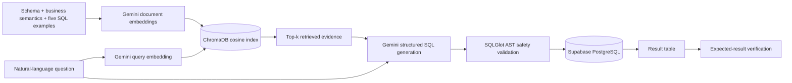

# Online Store SQL Quiz + RAG Text-to-SQL

[Live Streamlit application](https://ids706-sql-quiz-app-frp9u6b3ezf8spswjsjdlu.streamlit.app/) · [GitHub Actions](https://github.com/ThomasXu2026/IDS706-SQL-QUIZ-APP/actions)

This IDS 706 project combines the original authenticated five-question SQL quiz with the optional RAG Text-to-SQL assignment and its extra-credit execution and verification flow.

## Assignment coverage

| Requirement | Implementation |
|---|---|
| Preserve the existing SQL quiz | Authentication, five questions, saved answers, execution, grading, and total score remain available |
| Actual vector retrieval | Gemini embeddings are stored in ChromaDB and queried with cosine nearest-neighbor search |
| Schema retrieval | Separate documents describe `customers`, `products`, `orders`, and `order_items` |
| Business-semantics retrieval | Documents define sales revenue, order count, zero-order handling, naming, and ordering rules |
| Few-shot retrieval | All five solved quiz questions are indexed as natural-language/SQL examples |
| LLM-generated SQL | Gemini receives only the question and Chroma-retrieved context, then returns structured PostgreSQL |
| Extra credit: safe execution | Generated SQL is parsed, restricted to one read-only query, and run as `quiz_reader` in a read-only transaction |
| Extra credit: display and validation | The app displays query results and checks them against an automatically retrieved or explicitly selected expected result |

## RAG architecture



The index is built once per Streamlit process and cached. `gemini-embedding-001` creates 768-dimensional, normalized document and query vectors. ChromaDB performs the actual similarity search and returns evidence plus distances. Gemini then generates JSON with `sql` and `explanation` fields using the retrieved evidence.

## Features

- Supabase email/password authentication
- Five SQL questions worth 20 points
- Saved answers protected by Supabase Row Level Security
- Interactive execution and automatic result-based grading
- Gemini + ChromaDB RAG Text-to-SQL assistant
- Visible retrieval evidence and similarity distances
- Automatic or manual expected-result selection
- Generated-SQL execution, table display, and correctness verification
- SQL parser validation, dedicated `quiz_reader` role, read-only transactions, five-second timeout, and 100-row display limit

## Database

The hosted Supabase PostgreSQL database contains:

| Table | Purpose |
|---|---|
| `customers` | Customer names and identifiers |
| `products` | Product names and catalog prices |
| `orders` | Customer order headers |
| `order_items` | Product, quantity, and charged unit price for each order line |
| `quiz_answers` | Authenticated users' saved SQL answers, protected by RLS |

Student-written and Gemini-generated SQL both use the dedicated `quiz_reader` database role. The role has `SELECT` access to the four practice tables and no write privileges.

## How to use the deployed app

1. Open the [live application](https://ids706-sql-quiz-app-frp9u6b3ezf8spswjsjdlu.streamlit.app/).
2. Create an account or sign in.
3. Use the original quiz to run, save, check, and grade SQL answers.
4. In **RAG Text-to-SQL Assistant**, enter a database question in plain English.
5. Keep **Auto-detect** validation or select a specific quiz result.
6. Select **Retrieve Context and Generate SQL**.
7. Review the generated SQL, explanation, retrieved evidence, evidence types, and distances.
8. Select **Run Generated SQL and Verify** to execute the query and compare its output with the expected result.

## Local setup

Use Python 3.12.

```bash
git clone https://github.com/ThomasXu2026/IDS706-SQL-QUIZ-APP.git
cd IDS706-SQL-QUIZ-APP
python -m venv .venv
pip install -r requirements.txt
streamlit run app.py
```

Create `.streamlit/secrets.toml` locally. Never commit this file.

```toml
SUPABASE_URL = "YOUR_SUPABASE_URL"
SUPABASE_KEY = "YOUR_PUBLISHABLE_KEY"

DB_HOST = "YOUR_SESSION_POOLER_HOST"
DB_PORT = 5432
DB_NAME = "postgres"
DB_USER = "YOUR_READ_ONLY_DATABASE_USER"
DB_PASSWORD = "YOUR_READ_ONLY_DATABASE_PASSWORD"

GEMINI_API_KEY = "YOUR_GEMINI_API_KEY"
# Optional; defaults to the stable gemini-3.8-flash model
GEMINI_MODEL = "gemini-3.8-flash"
```

The deployed application reads the same names from Streamlit Community Cloud Secrets. No API key or database password is stored in the repository.

## Testing and CI

Run the secret-free unit tests locally:

```bash
pytest -q tests/test_core.py
```

They verify SQL safety rules, numeric result normalization, and the presence of all three RAG evidence types. GitHub Actions runs these tests for pull requests and pushes to `main`.

The protected database integration test runs on `main` and manual dispatch using GitHub repository secrets. It verifies:

- connection as `quiz_reader`;
- expected row counts in the four practice tables; and
- absence of `INSERT` permission.

Gemini calls are intentionally not made in CI, so the Gemini key remains only in Streamlit Cloud Secrets and API usage is not consumed by routine test runs.

## Project structure

```text
.
├── app.py                     # Streamlit quiz and RAG user interface
├── database.py                # SQL AST validation, read-only execution, grading
├── knowledge_base.py          # Schema, semantics, and few-shot documents
├── rag.py                     # Gemini embeddings, Chroma retrieval, generation
├── questions.py               # Five questions and expected results
├── requirements.txt
├── tests/
│   ├── test_core.py           # Secret-free unit tests
│   └── test_database.py       # Hosted database integration test
└── .github/workflows/
    └── database-test.yml
```

## Deployment

- Hosting: Streamlit Community Cloud
- Source branch: `main`
- Main file: `app.py`
- Authentication and database: Supabase
- Vector store: in-memory ChromaDB, rebuilt and cached per app process
- Embeddings and SQL generation: Gemini API
- Live URL: https://ids706-sql-quiz-app-frp9u6b3ezf8spswjsjdlu.streamlit.app/

Streamlit Community Cloud redeploys from `main`. After a deployment, verify sign-in, one original quiz query, retrieval evidence, generated SQL, safe execution, and expected-result matching.
