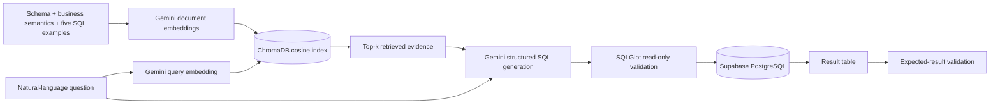

# Online Store SQL Quiz

A web-based SQL quiz built with Python, Streamlit, Supabase, and PostgreSQL.

The application allows students to sign in, answer SQL questions, execute queries against a hosted PostgreSQL database, and view their results. Students can also save answers and check their scores.

## Live Application

**Quiz URL:** https://ids706-sql-quiz-app-frp9u6b3ezf8spswjsjdlu.streamlit.app/

**GitHub Repository:** https://github.com/ThomasXu2026/IDS706-SQL-QUIZ-APP

Students can create an account, sign in, run SQL queries, save answers, and view their quiz results.

## Features

- Email and password authentication using Supabase Auth
- Hosted PostgreSQL database with sample retail data
- Five SQL questions worth 20 points total
- Interactive SQL editor with live query execution
- Expected SQL and results provided as hints
- Save and retrieve answers for each authenticated user
- Automatic grading based on query results
- Read-only database access for student queries
- Gemini-generated SQL from natural-language questions
- Actual ChromaDB vector retrieval over schema, business semantics, and five few-shot examples
- Optional read-only execution, result display, and expected-result validation for generated SQL

## Technology Stack

| Technology | Purpose |
|---|---|
| Python | Backend logic |
| Streamlit | Web interface |
| Supabase | Authentication and hosted PostgreSQL |
| psycopg | PostgreSQL connection and query execution |
| GitHub Actions | Automated database connection testing |
| Streamlit Community Cloud | Web hosting |
| Gemini API | Embeddings and SQL generation |
| ChromaDB | Vector storage and similarity retrieval |
| SQLGlot | Generated SQL safety validation |

## Database

The application uses a hosted Supabase PostgreSQL database.

### Tables

| Table | Description |
|---|---|
| customers | Customer information |
| products | Product names, categories, and prices |
| orders | Customer orders and dates |
| order_items | Ordered products, quantities, and prices |
| quiz_answers | Saved SQL answers associated with authenticated users |

The database contains sample online retail data used for SQL practice.

The `quiz_answers` table uses Row Level Security (RLS) so that authenticated users can only access their own saved answers.

## SQL Quiz

The quiz contains five questions, each worth four points.

| Question | Topic | Points |
|---|---|---|
| Q1 | Product Filtering | 4 |
| Q2 | Top 5 Products | 4 |
| Q3 | Orders by Customer | 4 |
| Q4 | Frequent Customers | 4 |
| Q5 | Sales by Product | 4 |
| **Total** | | **20** |

Questions cover SELECT, WHERE, ORDER BY, LIMIT, JOIN, GROUP BY, HAVING, COUNT, and SUM.

Each question includes instructions, expected SQL, and an expected result table.

## How to Use

1. Open the live quiz website.
2. Select **Sign Up** to create an account, or **Sign In** if you already have one.
3. Confirm your email address if prompted, then sign in.
4. Select a question from the dropdown menu.
5. Write a SQL query in the editor.
6. Click **Run Query** to execute the query and view the results.
7. Click **Save Answer** to store the SQL query.
8. Click **Check Answer** to compare the result with the expected output.
9. Click **Grade All Saved Answers** to calculate the total score.
10. In **RAG Text-to-SQL Assistant**, enter a natural-language database question.
11. Click **Retrieve Context and Generate SQL** to view retrieved evidence and AI-generated SQL.
12. For extra credit, the generated SQL automatically executes with read-only access, displays its result table, and compares the result with the expected answer. Use **Re-run Generated SQL and Verify** only when a retry is needed.

Students can return to previously saved answers after signing in again.

## Automatic Grading

Each question is worth four points.

The grading system compares the executed query result with the expected result, including column names, row values, and result order.

Correct answers receive four points, while incorrect or missing answers receive zero points.

Different SQL statements are accepted if they produce the expected result.

The total score is calculated from the user's saved SQL answers.

## Authentication and Security

Supabase Auth manages user authentication.

Unauthenticated users cannot execute SQL queries or save quiz answers through the application.

Student SQL queries use a dedicated PostgreSQL role, `quiz_reader`, which has SELECT permissions on the four practice tables.

Database queries run in read-only transactions with a five-second statement timeout.

Database passwords and API configuration are stored in application secrets rather than committed to GitHub.

## Local Setup

### 1. Clone the repository

```bash
git clone https://github.com/ThomasXu2026/IDS706-SQL-QUIZ-APP.git
cd IDS706-SQL-QUIZ-APP
```

### 2. Install dependencies

```bash
python -m venv .venv
```

Activate the virtual environment, then run:

```bash
pip install -r requirements.txt
```

### 3. Configure Supabase

Create a Supabase project with the required PostgreSQL tables and enable email authentication.

Create a read-only database role for executing student SQL queries.

Create `.streamlit/secrets.toml` with the following configuration:

```toml
SUPABASE_URL = "YOUR_SUPABASE_URL"
SUPABASE_KEY = "YOUR_PUBLISHABLE_KEY"

DB_HOST = "YOUR_SESSION_POOLER_HOST"
DB_PORT = 5432
DB_NAME = "postgres"
DB_USER = "YOUR_READ_ONLY_DATABASE_USER"
DB_PASSWORD = "YOUR_READ_ONLY_DATABASE_PASSWORD"

GEMINI_API_KEY = "YOUR_GEMINI_API_KEY"
# Optional; defaults to gemini-3.8-flash
GEMINI_MODEL = "gemini-3.8-flash"
```

Use the Supabase Session Pooler connection parameters and require SSL for database connections.

Do not commit `secrets.toml` or database passwords to GitHub.

### 4. Run the application

```bash
streamlit run app.py
```

Open the local application at:

http://localhost:8501

Sign in using a Supabase Auth account.

## GitHub Actions

GitHub Actions automatically tests the connection to the hosted Supabase PostgreSQL database.

The workflow is defined in `.github/workflows/database-test.yml`.

The test verifies:
- Successful PostgreSQL connection using the `quiz_reader` role
- Expected row counts in the four practice tables
- Read-only database permissions

Database credentials are securely stored using GitHub Actions Repository Secrets.

The workflow runs automatically on pull requests and pushes to the `main` branch and can also be triggered manually. Secret-free unit tests cover SQL safety, result normalization, and RAG knowledge coverage. The protected database integration test runs on `main` using GitHub repository secrets.

**Workflow Status:** Successfully tested.

**Actions:** https://github.com/ThomasXu2026/IDS706-SQL-QUIZ-APP/actions

## Deployment

The application is deployed on Streamlit Community Cloud.

- Hosting: Streamlit Community Cloud
- Database: Supabase PostgreSQL
- Authentication: Supabase Auth
- Source: GitHub main branch
- Main file: app.py

Application secrets are configured securely in Streamlit Community Cloud.

Live URL: https://ids706-sql-quiz-app-frp9u6b3ezf8spswjsjdlu.streamlit.app/

## Project Structure

```text
sql-quiz-app/
├── app.py
├── database.py
├── knowledge_base.py
├── rag.py
├── questions.py
├── requirements.txt
├── README.md
├── tests/
│   ├── test_core.py
│   └── test_database.py
├── .github/workflows/
│   └── database-test.yml
├── .gitignore
└── .streamlit/
    └── secrets.toml  (local only)
```

## RAG Text-to-SQL Extension

The optional IDS 706 RAG extension follows this required workflow:

**Natural-language question → Gemini query embedding → ChromaDB retrieval → Gemini SQL generation**

At startup, the application creates Gemini embeddings for separate database-schema documents, business-semantics documents, and all five solved quiz questions as few-shot examples. ChromaDB stores these vectors and performs cosine similarity search for every user question. Only the top retrieved evidence and the user question are sent to Gemini to generate PostgreSQL.

For the extra-credit flow, SQLGlot parses the generated SQL and rejects non-read-only or multiple statements. Valid SQL automatically runs through the existing `quiz_reader` role in a read-only transaction immediately after generation. The application displays the result table and automatically compares it with the selected or detected expected quiz result.

### RAG architecture



The implementation uses `gemini-embedding-001` for 768-dimensional normalized embeddings and `gemini-3.8-flash` by default for structured SQL generation. The ChromaDB index is cached per Streamlit process.

### RAG screenshots

**Basic requirement — natural-language question and generated SQL**


**Extra credit — read-only execution, result table, and successful validation**


### RAG tests

Run the secret-free unit tests locally:

```bash
python -m pytest -q tests/test_core.py
```

Gemini calls are intentionally excluded from CI so the API key stays only in Streamlit Community Cloud Secrets and routine tests do not consume API usage.

## Notes

The quiz is designed for educational SQL practice using sample retail data.

The database and authentication services are hosted on Supabase. Students interact with the database through the Streamlit application.

SQL answers are stored in PostgreSQL, while grades are calculated when the grading function is executed.
